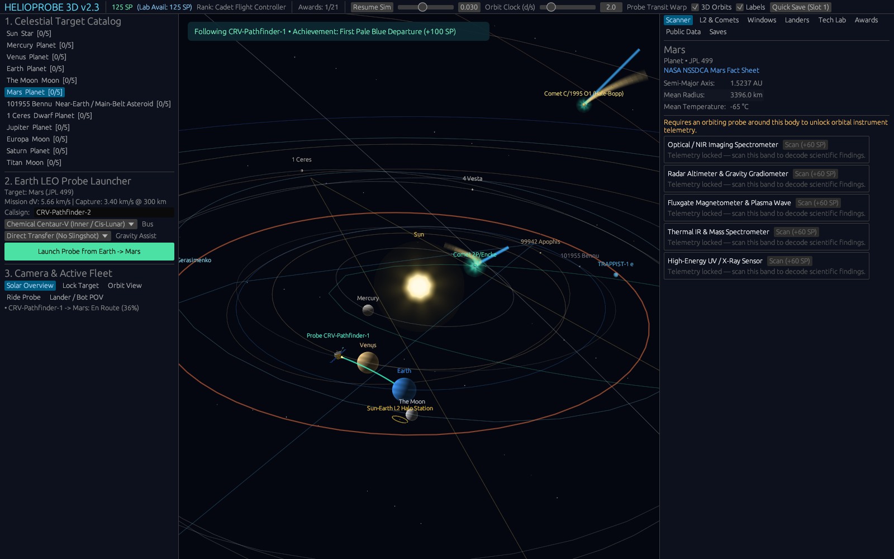

# HelioProbe (`helioprobe` v2.3.0)



Native safe-Rust (`#![forbid(unsafe_code)]` library crate) 3D graphical space probe, universal-variable Lambert Porkchop & gravity-assist planner, Sun–Earth L2 halo observatory simulator, eccentric comet plasma/dust-tail visualizer, surface lander & ocean-world cryobot POV, atmospheric entry probe, sample-return, and public astronomy simulator built with `eframe`/`egui` (`0.31`), `wgpu` (`shaders/cosmos.wgsl`), bundled `rusqlite` SQLite WAL persistence, and `ureq` live astronomical harvesters.

- **Website**: [CRV Science Network](https://crvscience.com) · [CRV Science Public Apps](https://crvscience.com/apps)
- **Documentation**: [User Guide](docs/USER_GUIDE.md) · [Scientific Methods](docs/SCIENTIFIC_METHODS.md)
- **License**: GNU General Public License v3.0 or later (`GPL-3.0-or-later`, see [LICENSE](LICENSE))

---

## Build & Run Quickstart

```bash
# Run interactive 3D GUI simulator (release optimization)
cargo run --release

# Run full unit + integration test suite
cargo test --all-targets

# Compute Saturn 3D Lambert Porkchop basin & Jupiter slingshot from CLI
cargo run --release -- porkchop saturn

# Render an offscreen 1600x1000 RGBA screenshot without opening a window
cargo run --release -- --headless-screenshot view1.png --screenshot-view 1
```

---

## Interactive Controls & Hotkeys

All hotkeys except `F1` and `Esc` are guarded by `!ctx.wants_keyboard_input()` so typing in search or API fields never triggers viewport shortcuts.

| Control / Key | Action |
| :--- | :--- |
| **Left-Drag Viewport** | Orbit camera (`yaw` / `pitch`) around current target |
| **Scroll Wheel** | Exponentially damped smooth zoom (`0.015`–`260.0` units) |
| **Click Body in 3D** | Select target body in Catalog & Scanner |
| **`1` – `5`** | Switch camera mode (`1` Solar Overview, `2` Lock Target, `3` Orbit View, `4` Ride Probe, `5` Lander / Bot POV) |
| **`R`** | Reset camera to default Solar Overview |
| **`O` / `L`** | Toggle 3D orbital ribbons / de-overlapped body labels |
| **`Ctrl+F`** (`Cmd+F`) | Focus Celestial Target Catalog search box |
| **`Ctrl+K`** (`Cmd+K`) | Open fuzzy Quick-Jump Mission & Transfer Palette (focus bodies/L2/probes, time warp presets, transfer planner, and exports) |
| **`Space`** | Pause / Resume ephemeris and probe simulation clock |
| **`F5`** | Quick Save campaign to SQLite Slot 1 |
| **`F1` / `Esc`** | Toggle About & Controls Reference modal / Close modal or Mission Log |

---

## CLI Flags & Subcommands

| Flag / Subcommand | Default / Args | Description |
| :--- | :--- | :--- |
| `--db <PATH>` | `helioprobe_saves.db` | Path to SQLite WAL campaign database |
| `--headless-screenshot <PATH>` | *(optional)* | Render offscreen `1600x1000` PNG without a GUI window |
| `--screenshot-view <1\|2\|3>` | `1` | Preset view (`1` Solar System, `2` Sun–Earth L2 & Halley, `3` Europa Cryobot POV) |
| `sync-sbdb <QUERY>` | `<query>` | Query live NASA JPL SBDB API and output JSON |
| `sync-exoplanet <NAME>` | `<name>` | Query live NASA Exoplanet Archive TAP service and output JSON |
| `sync-simbad <IDENTIFIER>` | `<identifier>` | Query live CDS SIMBAD TAP service and output JSON |
| `porkchop [TARGET_ID]` | `saturn` | Print synodic period, Lambert Porkchop optimum, and Gravity-Assist options |
| `budget` | `[--targets <IDS>] [--format <table\|json\|csv>] [--output <PATH>]` | Compare multi-target Hohmann and Sun–Earth L2 transfer $\Delta v$, $C_3$, and time-of-flight mission budgets (also interactive in the `Windows` tab) |
| `slots` | — | List saved campaigns in `--db` |

---

## Scientific Summary & Architecture

| Module | Scope & Key Capabilities |
| :--- | :--- |
| `src/catalog.rs` | **46 verified celestial targets** (**230** 5-band instrument findings): Sun, 8 planets, 5 IAU dwarf planets, 10 moons, 4 asteroids, 4 eccentric comets (`2P/Encke`, `67P/C-G`, `1P/Halley`, `C/1995 O1 Hale–Bopp`), Sun–Earth L2, 5 exoplanets, and 8 deep-sky nebulae |
| `src/physics.rs` | Safeguarded Keplerian solver, right-handed J2000 `kepler_state_ecliptic_km`, Laguerre universal-anomaly propagator (`propagate_kepler_ecliptic_km`), unified giant-planet (`e = 0.60`) capture `compute_capture_orbit`, and relativistic interstellar transfer (`Δv = 2·c·atanh(β) + v_cap`, `τ = t / γ`) |
| `src/astrodynamics_lab.rs` | 3D universal-variable Lambert solver (`dm = ±1`), Porkchop Δv/C3 contour matrix (memoized in `src/gui.rs`), and 2-leg patched-conic Gravity-Assist Slingshots (`Venus`, `Mars`, `Jupiter`, `Saturn`) |
| `src/l2_comets.rs` | Exact Sun–Earth Hill radius `r_L2 = a_E·(μ_E/(3μ_sun))^(1/3)`, CR3BP collinear quintic & linearized halo frequencies `(ω_xy, ω_z)`, 3 L2 observatories (`JWST`, `Roman`, `Comet Interceptor`), and physical ecliptic-velocity solar-wind ion-tail aberration `α = atan2(v_perp, v_sw - v_r)` |
| `src/probes.rs` | 4 propulsion buses (`ChemicalCentaur`, `SolarElectricIon`, `RtgNuclearElectric`, `LaserSailFusion`), 2-leg slingshot & L2 interceptor flights, proper-time tracking |
| `src/surface_ops.rs` | Aero-Shell / Sky-Crane landers, Pu-238 GPHS Ocean Cryobots (`12` icy worlds), Galileo-class Atmospheric Entry / Kinetic Crash probes (`14` atmospheric worlds + airless targets), and Earth Sample-Return Capsules (`SRC`) |
| `src/renderer_3d.rs` & `shaders/cosmos.wgsl` | Custom `wgpu` pipeline: camera view-space solar lighting, 56-segment 3D obliquity-tilted planetary rings with planet shadow attenuation, uniform eccentric-anomaly (`E`) orbit ribbons, polyhedral spacecraft/lander meshes |
| `src/gui.rs` | `eframe`/`egui` Mission Control UI: memoized Porkchop plot with Viridis colormap, marching-squares iso-Δv contours, numeric X/Y ticks, smooth damped zoom, tooltips, `Ctrl+F` search focus, `F1` quick reference |
| `src/tech_tree.rs` & `src/gamification.rs` | **8** tech-tree upgrades (`available_sp = science_points - spent_sp`), **21** achievements, **5** agency ranks, 3-slot SQLite WAL + JSON persistence |
| `src/public_data.rs` | Non-blocking background NASA JPL SBDB, Horizons, Exoplanet Archive TAP, and CDS SIMBAD TAP harvesters |

---

## Validation Metrics

Observed outputs from `cargo test --all-targets` and CLI runs on this codebase:

- **Test Suite (`cargo test --all-targets`)**: **30 passed, 0 failed** (`7` library unit tests in `src/lib.rs`, `1` CLI parser test in `src/main.rs`, `22` integration tests in `tests/simulation_tests.rs`, `0` compiler warnings).
- **Lambert Round-Trip & Hyperbolic Propagation**: 3D Lambert transfer to inclined `1 Ceres` (`dt = 260 d`) round-trips within `< 5.0 km`; full `20 x 20` Porkchop grid across 9 diverse bodies produces `0` NaNs with `< 10.0 km` position / `< 1e-2 km/s` velocity error; hyperbolic `40 d` and `1200 d` propagations agree with 8,000–12,000-step RK4 within `< 1.0 km`.
- **Halley Ion-Tail Aberration**: `compute_comet_tail_state` for `1P/Halley` (`e = 0.9672`) agrees with `atan2(v_perp, v_sw - v_r)` within `< 1e-6 deg` (target threshold `< 1.0 deg`) across perihelion, inbound, outbound, and outer anomalies.
- **Launcher vs. Porkchop Capture Reconciliation (`porkchop saturn` / `porkchop jupiter`)**:
  - **Saturn**: Synodic period `378.1 d`, Optimal Lambert Porkchop Basin `+241.6 d`, Flight `2543.1 d`, Min Δv `11.52 km/s`; Jupiter gravity assist saves `1.69 km/s` (`10.21 km/s` assisted, `101.7 deg` bend @ `45,000 km`).
  - **Jupiter**: Synodic period `398.9 d`, Optimal Lambert Porkchop Basin `+390.8 d`, Flight `1384.8 d`, Min Δv `12.80 km/s`.
- **Sun–Earth L2 CR3BP Dynamics**: Hill radius `r_L2 = 1,496,558 km`, CR3BP collinear distance `1,501,154 km` (`c_2 ≈ 3.9405`), linearized halo periods `T_xy ≈ 177.6 d`, `T_z ≈ 184.0 d`.

---

## Citation & License

Licensed under **GPL-3.0-or-later** (see [LICENSE](LICENSE)). Citation metadata is provided in [CITATION.cff](CITATION.cff):

```bibtex
@software{white2026helioprobe,
  author  = {White, Bryan P.},
  title   = {HelioProbe: 3D Space Probe, Sun-Earth L2 Observatory, Comet Tail, and Cryobot Simulator},
  version = {2.3.0},
  year    = {2026},
  doi     = {10.5281/zenodo.24244083},
  url     = {https://crvscience.com/apps},
  license = {GPL-3.0-or-later}
}
```
